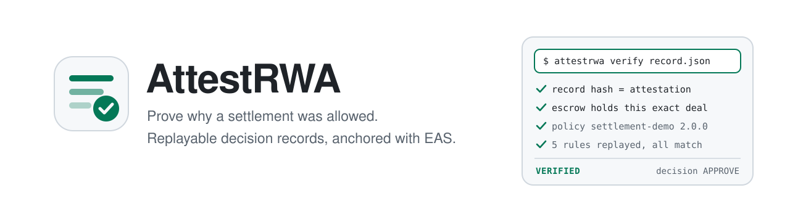
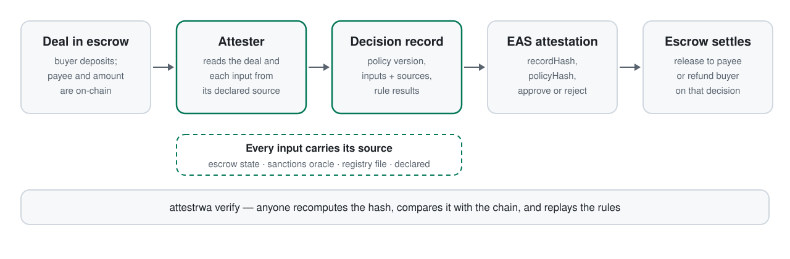
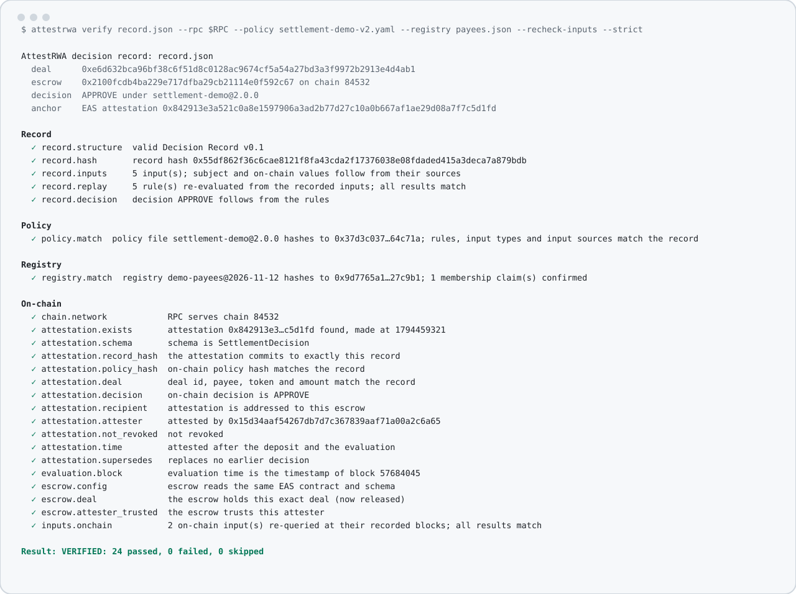
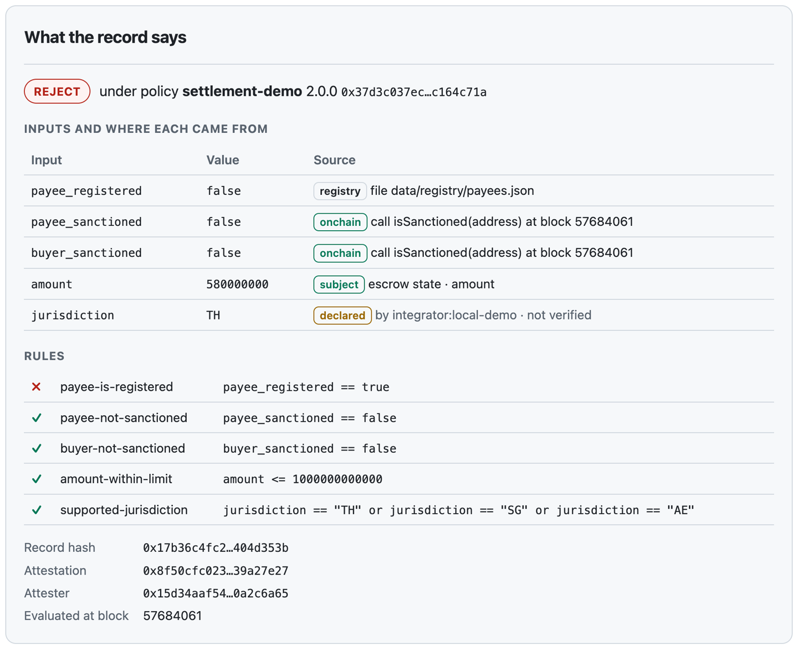
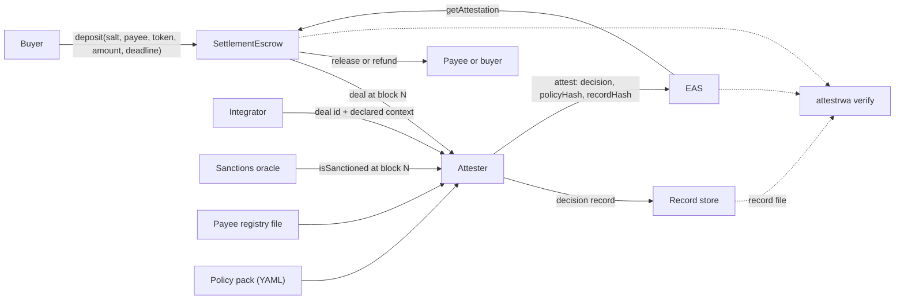

<p align="center">
  <picture>
    <source media="(prefers-color-scheme: dark)" srcset="docs/assets/banner-dark.svg">
    
  </picture>
</p>

<p align="center">
  <a href="https://github.com/FUYOH666/attestrwa/releases/latest"></a>
  <a href="https://github.com/FUYOH666/attestrwa/actions/workflows/ci.yml"></a>
  <a href="spec"></a>
  
  
  <a href="LICENSE"></a>
</p>

<p align="center">
  <a href="#quick-start">Quick start</a> ·
  <a href="#features">Features</a> ·
  <a href="#what-a-record-proves">What a record proves</a> ·
  <a href="#records-for-ai-decisions">AI decisions</a> ·
  <a href="#for-ai-agents">For AI agents</a> ·
  <a href="#how-it-works">How it works</a> ·
  <a href="#faq">FAQ</a> ·
  <a href="README.ru.md">Русский</a>
</p>

**Prove why a settlement was allowed — to anyone, after the fact.** AttestRWA turns a compliance decision about a stablecoin settlement into a *decision record*: which policy version was applied, which inputs were used and where each came from, which rules held. The record's hash is anchored on-chain with the [Ethereum Attestation Service](https://attest.org), an escrow settles only on that decision, and anyone holding the record can re-check it with one command. It is a format, a verifier and a reference implementation for teams that must later explain a decision to an auditor, a counterparty or a regulator.

The same record works where there is no chain at all: [format 0.2](#records-for-ai-decisions) signs it with a key and lets it cite documents, the output of an AI model and a reviewer's sign-off.

<p align="center">
  <picture>
    <source media="(prefers-color-scheme: dark)" srcset="docs/assets/how-it-works-dark.svg">
    
  </picture>
</p>

## Why

A compliance check before a payment is easy to run and hard to prove. The decision is made inside one company's systems; what everyone else sees later is the outcome. Which policy was in force that day, which screening result was used, whether the payee was the one the buyer meant — these are reconstructed from logs, if they can be reconstructed at all.

On-chain policy engines and gated tokens answer "may this transfer happen?". AttestRWA answers the question that comes afterwards: **"why was it allowed, and can I check that myself?"** It does not replace screening vendors or policy engines; it records what they said, in a form that does not depend on trusting the party that made the decision. See [where it fits](docs/LANDSCAPE.md).

## Quick start

Requirements: [Foundry](https://book.getfoundry.sh/getting-started/installation), [uv](https://docs.astral.sh/uv/), [pnpm](https://pnpm.io/installation) with Node 22.18 or newer. No wallet and no faucet: the demo runs on a local fork of Base Sepolia, with the real EAS contracts and the real Chainalysis sanctions oracle.

```bash
git clone https://github.com/FUYOH666/attestrwa.git && cd attestrwa
./scripts/demo-mode.sh        # fork, contracts, attester on :8080, web UI on :3000
./scripts/e2e_rwa_flow.sh     # deposit -> APPROVE -> record verified -> release
./scripts/e2e_rwa_reject.sh   # deposit -> attacks refused -> REJECT -> verified -> refund
```

Each script ends by running the verifier in strict mode on the record it just produced:

<p align="center">
  <picture>
    <source media="(prefers-color-scheme: dark)" srcset="docs/assets/verify-cli-dark.svg">
    
  </picture>
</p>

Then open <http://localhost:3000/settle> to run a settlement by hand, and <http://localhost:3000/verify> to check a record in the browser. Stop everything with `./scripts/stop-demo-mode.sh`. Details: [docs/LOCAL_DEMO.md](docs/LOCAL_DEMO.md).

To try only the verifier, without cloning, check a published test vector offline:

```bash
curl -sO https://raw.githubusercontent.com/FUYOH666/attestrwa/main/spec/test-vectors/record-approve.json
uvx --from "git+https://github.com/FUYOH666/attestrwa#subdirectory=packages/attestrwa" attestrwa verify record-approve.json
```

## Features

- **Decision Record v0.1.** One canonical JSON document per decision: policy id, version and hash; every input with its source; every rule with its result; the outcome. [Specification](spec/DECISION_RECORD_v0.1.md), [JSON Schema](spec/decision-record-0.1.schema.json) and [test vectors](spec/test-vectors) are in the repository.
- **Decision Record v0.2: signed records, no chain.** The same record for a decision that has no escrow, signed with Ed25519. Inputs may come from documents cited by hash, from a named field of an AI model's output, and from a named reviewer. [Specification](spec/DECISION_RECORD_v0.2.md), [JSON Schema](spec/decision-record-0.2.schema.json), [worked example](examples/ai-classification).
- **Independent verifier.** `attestrwa verify` recomputes the hash, compares the record with the EAS attestation and with the escrow's own state, checks the policy and registry files byte for byte, re-runs every rule and re-queries on-chain inputs at their recorded block. Two dependencies, exit code 0, 1 or 2.
- **Sources, not claims.** A policy declares where each input must come from: escrow state, a contract call, a registry file, or an explicit declaration. The attester reads the deal from the escrow and refuses any attempt by the caller to describe it.
- **A real screening source.** The demo policy reads the [Chainalysis sanctions oracle](https://go.chainalysis.com/chainalysis-oracle-docs.html) on Base at the evaluation block, so the screening result in a record can be re-checked by anyone.
- **Policy as hashed code.** Policies are YAML packs with a small typed rule language whose full grammar fits on a page; nothing is ever `eval`-ed. The policy hash is in the attestation, so "which version applied" has one answer.
- **An escrow that obeys only exact, live decisions.** Release and refund go through one gate: right schema, addressed to this escrow, trusted attester, not revoked, not expired, about exactly this deal. Funds can only move to the payee the buyer named or back to the buyer.
- **One decision per deal.** A repeat request returns the stored record. A new decision is possible only after the earlier attestation is revoked, and the new record names what it replaces.
- **A browser verifier.** `/verify` checks a record with no server in between: the page recomputes the hash and reads the attestation and the escrow straight from an RPC endpoint.

## What a record proves

<p align="center">
  
</p>

A verified record proves that:

1. the attester committed, at a known time, to exactly these bytes;
2. the decision is the result of applying the stated rules to the stated inputs;
3. the rules are those of a policy file with a known hash;
4. inputs taken from the escrow or from an on-chain call follow from that source, were read at one block, and can be re-queried there.

It does **not** prove that an input from a registry, an off-chain provider or a declaration was true. The record makes the origin of every input explicit — the `declared` jurisdiction above is marked as not verified — so a reviewer can decide how much weight each one deserves. Address-list screening, for example, says nothing about a freshly created wallet.

| | Policy engines and gated tokens | AttestRWA |
|---|---|---|
| Question answered | May this transfer happen? | Why was it allowed, and can a third party check? |
| Output | An allow or deny at execution time | A replayable record plus an on-chain commitment |
| Who can verify | The operator, inside its system | Anyone with the record and an RPC endpoint |
| Relationship | — | Records what such systems decided; does not replace them |

A fuller comparison with named projects and sources: [docs/LANDSCAPE.md](docs/LANDSCAPE.md).

## Records for AI decisions

"Why was this allowed?" is asked of any decision a model helps to make: a tariff classification, a credit limit, a claim. The usual answer is a log line inside the system that made the decision. Format 0.2 gives the same answer as for a settlement: a record of what the model said, what it was shown, which rules held and who signed off, that a third party can check without access to that system.

The [worked example](examples/ai-classification) is a customs classification: two models propose a tariff code, a policy requires them to agree, to be confident, to have documents behind the description and to have a reviewer's sign-off. After cloning:

```bash
uvx --from ./packages/attestrwa attestrwa verify examples/ai-classification/records/approve.json \
  --policy examples/ai-classification/policy.yaml \
  --document-dir examples/ai-classification/case-approve \
  --public-key 0xd75a980182b10ab7d54bfed3c964073a0ee172f3daa62325af021a68f707511a \
  --strict
```

```text
Record
  ✓ record.replay     5 rule(s) re-evaluated from the recorded inputs; all results match
  ✓ record.decision   decision APPROVE follows from the rules
Policy
  ✓ policy.match      rules, input types and input sources match the record
Documents
  ✓ documents.match   all 7 cited file(s) supplied; every hash matches
  ✓ model.output      3 value(s) equal the named field of the model output
Signature
  ✓ signature.valid   valid Ed25519 signature by 0xd75a9801…07511a
  ✓ signature.signer  signed by the key you trust
```

(Abridged; the example's README shows the full output.) Change one character of the invoice, raise the recorded confidence or name another reviewer, and the result is `NOT VERIFIED`. No blockchain, no network and no account are involved: a record is a file, a policy file, the documents and a public key.

What it proves is deliberately narrow. The documents, the prompt and the model output are byte for byte the ones the decision used; the values came from where the policy says they must; the decision follows from the rules; the holder of a known key committed to all of it. It does **not** prove that a model produced the output, that the reviewer really signed off, or when: those remain statements of the signer, now explicit and individually disputable. The example is signed with a published test key, and the verifier says so. Details: [section 2 of the specification](spec/DECISION_RECORD_v0.2.md#2-what-a-case-record-proves-and-what-it-does-not).

To sign your own records: `attestrwa keygen`, `build_case_record` in the library, `attestrwa sign`. The example's [`make_records.py`](examples/ai-classification/make_records.py) is the whole integration.

## For AI agents

The verifier is a library as well as a command:

```python
from pathlib import Path

from attestrwa import load_policy, loads_strict, verify
from attestrwa.rpc import JsonRpc

report = verify(
    loads_strict(Path("record.json").read_bytes()),   # refuses duplicate keys and floats
    rpc=JsonRpc("https://sepolia.base.org"),
    policy=load_policy("data/policies/settlement-demo-v2.yaml"),
    recheck_inputs=True,
)
print(report.verdict)                                  # VERIFIED / NOT VERIFIED / CONSISTENT (...)
for check in report.checks:
    print(check.status, check.id, check.detail)
```

For a signed case, pass the files and the key you trust instead of an RPC endpoint: `verify(doc, policy=..., documents=[(name, content), ...], public_key="0x…")`.

The local attester speaks plain HTTP on `http://127.0.0.1:8080` (OpenAPI at `/docs`). A request names a deal and nothing else:

```bash
curl -s http://127.0.0.1:8080/attest/settlement \
  -H 'Content-Type: application/json' -H 'X-API-Key: local-demo-key' \
  -d '{"chain_id": 84532, "escrow": "0x…", "deal_id": "0x…", "declared": {"jurisdiction": "TH"}}'
```

`GET /records/{deal_id}` returns the record, `POST /verify` runs the verifier on one. Reference: [docs/API.md](docs/API.md). For coding agents working on this repository: [AGENTS.md](AGENTS.md) and [llms.txt](llms.txt).

## How it works



- **The decision is a pure function.** `build_record` takes a policy and inputs and returns the record; approve if and only if every rule holds. There is no decision logic outside the policy, so replaying the rules reproduces the decision.
- **The attester reads, the caller only names.** Buyer, payee, token and amount come from the escrow at a fixed block. This is what closes the hole of the first version, where a buyer could ask for a decision about a payee of their choosing and use the rejection to exit early.
- **Hash on-chain, record off-chain.** The attestation carries the outcome and two hashes. Reasons stay in the record, which the attester can keep private and disclose to those entitled to it.
- **State reads, not receipts.** The verifier uses `eth_call` only. Public RPC endpoints prune old receipts and logs but keep serving contract state, so a record stays checkable.
- **Real EAS in tests.** The Foundry suite deploys the actual EAS and SchemaRegistry contracts instead of a mock; the local demo forks Base Sepolia for the same reason.

More: [docs/ARCHITECTURE.md](docs/ARCHITECTURE.md), [docs/THREAT_MODEL.md](docs/THREAT_MODEL.md), [docs/POLICY_PACKS.md](docs/POLICY_PACKS.md), [docs/ATTESTATION_SCHEMA.md](docs/ATTESTATION_SCHEMA.md).

## Status

A testnet reference implementation, measured on 2026-11-12 at the tagged release:

| Part | Checks |
|---|---|
| Contracts | 78 Foundry tests: 71 unit and fuzz cases against the real EAS contracts, 3 invariants, 4 for the demo token. Slither reports nothing at medium or above (one documented suppression). |
| Library and verifier | 616 tests, including canonicalisation cross-checked against an independent RFC 8785 library, the Ed25519 test vector of RFC 8032, and both formats checked against their JSON Schemas. |
| Attester | 77 tests on an in-memory chain, including the refused attacks. |
| End to end | Approve and reject paths on a fork of Base Sepolia; each record verified in strict mode (24 checks). |
| Signed cases | The two example records verified in strict mode with their documents (10 checks); the published 0.1 vectors are pinned by hash. |

What it is not: it has had **no professional security audit**, it is **not deployed to mainnet**, the demo token is freely mintable, and the payee registry and policy are synthetic. A public Base Sepolia deployment with published records is the next step on the [roadmap](docs/ROADMAP.md). Nothing here is legal or compliance advice.

## FAQ

<details>
<summary><b>Does this replace KYC, sanctions screening or a policy engine?</b></summary>

No. Those produce the inputs and, often, the decision. AttestRWA records which inputs were used, from where, under which policy version, and lets a third party check that record. The reference attester has one real data source, the Chainalysis sanctions oracle, to show the pattern; a production deployment would add its own providers behind the same interface.
</details>

<details>
<summary><b>Why put anything on-chain?</b></summary>

For a timestamped commitment that the attester cannot later change, and so that a contract can act on the decision. Only the outcome and two hashes go on-chain. The record itself can stay private.
</details>

<details>
<summary><b>Is a rejection public?</b></summary>

The attestation says that a decision with outcome "reject" exists for a deal and names the payee address; it does not say why. That is still information about an address, and for some uses that alone is too much. The format works equally with approvals only, or with attestations on a private chain.
</details>

<details>
<summary><b>What if the attester key is stolen?</b></summary>

The thief can approve or reject deals, but cannot redirect money: the escrow pays only the payee the buyer named, or the buyer. The owner removes the attester with `setAttester(address, false)`, which invalidates every decision it has outstanding. Owner and attester are separate keys by construction. See the [threat model](docs/THREAT_MODEL.md).
</details>

<details>
<summary><b>Which chains?</b></summary>

Any chain with EAS. The reference targets Base and Base Sepolia, where EAS is a predeploy. The record format itself is not tied to an escrow or to a chain: format 0.2 adds a `case` subject anchored by a signature, which needs no chain at all.
</details>

<details>
<summary><b>Does a signed record prove the AI was right?</b></summary>

No, and it does not prove that a model produced the output either. It fixes what the decision was based on: these documents, this prompt, this output, these rules, this sign-off, committed to by a known key. A reviewer can then check each of those against a file that cannot have changed, instead of reconstructing the decision from logs.
</details>

<details>
<summary><b>Why a signature instead of the chain for those records?</b></summary>

A decision about a document needs no contract to act on it, and many teams cannot put anything on a public chain. A signature needs only a key. What it does not give is a timestamp or revocation; a producer that needs those can also publish the record's hash, which stays a keccak256 for that reason.
</details>

<details>
<summary><b>Why is the first decision on the local fork slow?</b></summary>

Anvil fetches the EAS contract's storage from the public RPC the first time it is touched. A decision takes about ten seconds on a fresh fork.
</details>

## Roadmap

Next is a public Base Sepolia deployment with published records, then co-signatures and a time anchor for signed records, and adapters for more input sources. [docs/ROADMAP.md](docs/ROADMAP.md) has the list; [docs/HISTORY.md](docs/HISTORY.md) explains where the project came from.

## For teams

AttestRWA is free and open source; run it yourself. If you want decision records wired into your own settlement, compliance or AI-assisted decision flow — your policy, your data sources, your models, your retention rules — write to [private@scanovich.ai](mailto:private@scanovich.ai) or Telegram [@ScanovichAI](https://t.me/ScanovichAI).

## Contributing

Issues and pull requests are welcome: [CONTRIBUTING.md](CONTRIBUTING.md). Security reports: [SECURITY.md](SECURITY.md). Changes: [CHANGELOG.md](CHANGELOG.md).

## Acknowledgments

[Ethereum Attestation Service](https://attest.org) · [OpenZeppelin Contracts](https://github.com/OpenZeppelin/openzeppelin-contracts) · [Foundry](https://github.com/foundry-rs/foundry) · [Chainalysis sanctions oracle](https://go.chainalysis.com/chainalysis-oracle-docs.html) · [viem](https://viem.sh) · [FastAPI](https://fastapi.tiangolo.com) · [Next.js](https://nextjs.org) · [RFC 8785](https://www.rfc-editor.org/rfc/rfc8785)

Apache-2.0 License · maintained by [Aleksandr Mordvinov](https://github.com/FUYOH666).
