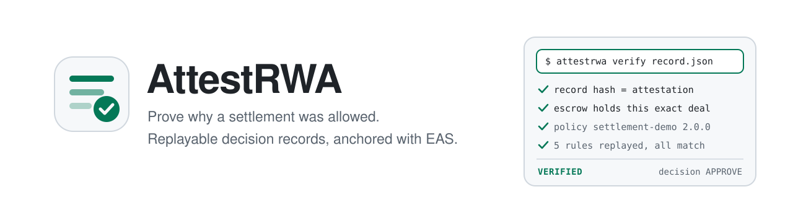
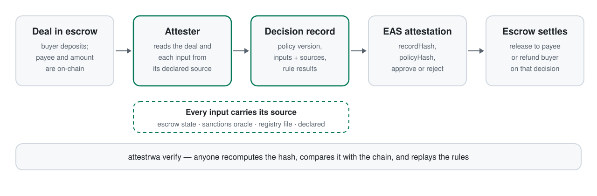
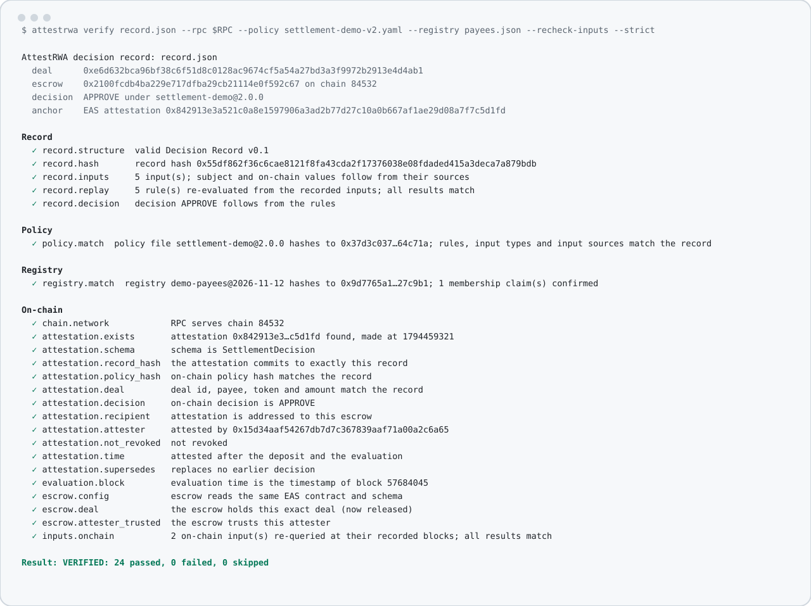
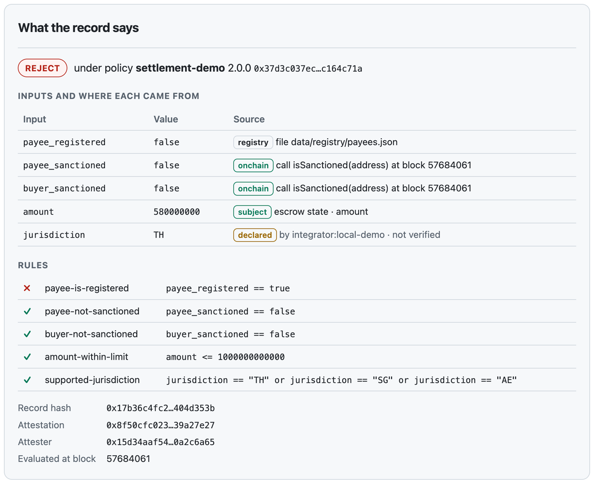
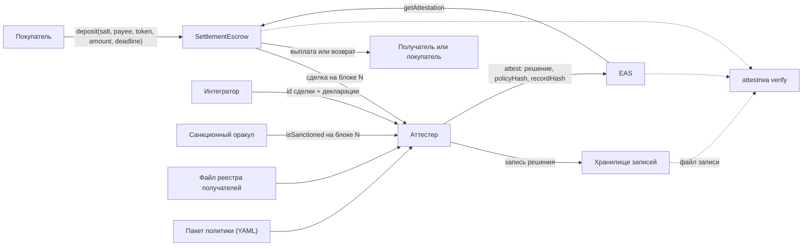

<p align="center">
  <picture>
    <source media="(prefers-color-scheme: dark)" srcset="docs/assets/banner-dark.svg">
    
  </picture>
</p>

<p align="center">
  <a href="https://github.com/FUYOH666/attestrwa/releases/latest"></a>
  <a href="https://github.com/FUYOH666/attestrwa/actions/workflows/ci.yml"></a>
  <a href="spec"></a>
  
  
  <a href="LICENSE"></a>
</p>

<p align="center">
  <a href="#быстрый-старт">Быстрый старт</a> ·
  <a href="#возможности">Возможности</a> ·
  <a href="#что-доказывает-запись">Что доказывает запись</a> ·
  <a href="#записи-для-решений-с-участием-ии">Решения ИИ</a> ·
  <a href="#для-ai-агентов">Для AI-агентов</a> ·
  <a href="#как-это-устроено">Как это устроено</a> ·
  <a href="#вопросы-и-ответы">Вопросы и ответы</a> ·
  <a href="README.md">English</a>
</p>

**Докажите, почему расчёт был разрешён — любому и задним числом.** AttestRWA превращает комплаенс-решение о расчёте в стейблкоинах в *запись решения*: какая версия политики применялась, какие входные данные использованы и откуда взято каждое, какие правила выполнились. Хеш записи закрепляется в блокчейне через [Ethereum Attestation Service](https://attest.org), эскроу рассчитывается только по этому решению, а любой, у кого есть запись, перепроверяет её одной командой. Это формат, верификатор и эталонная реализация для команд, которым позже придётся объяснять решение аудитору, контрагенту или регулятору.

Та же запись работает и там, где блокчейна нет вовсе: [формат 0.2](#записи-для-решений-с-участием-ии) подписывает её ключом и позволяет ссылаться на документы, на ответ ИИ-модели и на подтверждение проверяющего.

<p align="center">
  <picture>
    <source media="(prefers-color-scheme: dark)" srcset="docs/assets/how-it-works-dark.svg">
    
  </picture>
</p>

## Зачем

Комплаенс-проверку перед платежом легко выполнить и трудно доказать. Решение принимается внутри систем одной компании, а все остальные потом видят только результат. Какая политика действовала в тот день, какой результат скрининга был использован, тот ли это получатель, которого имел в виду покупатель, — всё это восстанавливают по логам, если вообще удаётся.

Ончейн-движки политик и токены с ограничениями отвечают на вопрос «можно ли выполнить этот перевод?». AttestRWA отвечает на следующий: **«почему его разрешили и могу ли я проверить это сам?»** Проект не заменяет поставщиков скрининга и движки политик — он фиксирует, что они сказали, в виде, который не требует доверять стороне, принявшей решение. Подробнее: [место среди других решений](docs/LANDSCAPE.md).

## Быстрый старт

Нужны [Foundry](https://book.getfoundry.sh/getting-started/installation), [uv](https://docs.astral.sh/uv/) и [pnpm](https://pnpm.io/installation) с Node 22.18 или новее. Кошелёк и кран не нужны: демо работает на локальном форке Base Sepolia с настоящими контрактами EAS и настоящим санкционным оракулом Chainalysis.

```bash
git clone https://github.com/FUYOH666/attestrwa.git && cd attestrwa
./scripts/demo-mode.sh        # форк, контракты, аттестер на :8080, веб-интерфейс на :3000
./scripts/e2e_rwa_flow.sh     # депозит -> APPROVE -> запись проверена -> выплата
./scripts/e2e_rwa_reject.sh   # депозит -> атаки отклонены -> REJECT -> проверка -> возврат
```

Каждый сценарий в конце запускает верификатор в строгом режиме на только что созданной записи:

<p align="center">
  <picture>
    <source media="(prefers-color-scheme: dark)" srcset="docs/assets/verify-cli-dark.svg">
    
  </picture>
</p>

Затем откройте <http://localhost:3000/settle>, чтобы провести расчёт вручную, и <http://localhost:3000/verify>, чтобы проверить запись в браузере. Остановить всё: `./scripts/stop-demo-mode.sh`. Подробности: [docs/LOCAL_DEMO.md](docs/LOCAL_DEMO.md).

Чтобы попробовать только верификатор, не клонируя репозиторий, проверьте опубликованный тестовый вектор офлайн:

```bash
curl -sO https://raw.githubusercontent.com/FUYOH666/attestrwa/main/spec/test-vectors/record-approve.json
uvx --from "git+https://github.com/FUYOH666/attestrwa#subdirectory=packages/attestrwa" attestrwa verify record-approve.json
```

## Возможности

- **Decision Record v0.1.** Один каноничный JSON-документ на решение: идентификатор, версия и хеш политики; каждое входное значение с источником; каждое правило с результатом; итог. [Спецификация](spec/DECISION_RECORD_v0.1.md), [JSON Schema](spec/decision-record-0.1.schema.json) и [тестовые векторы](spec/test-vectors) лежат в репозитории.
- **Decision Record v0.2: подписанные записи без блокчейна.** Та же запись для решения, у которого нет эскроу, с подписью Ed25519. Входные значения могут приходить из документов, указанных по хешу, из названного поля ответа ИИ-модели и от названного проверяющего. [Спецификация](spec/DECISION_RECORD_v0.2.md), [JSON Schema](spec/decision-record-0.2.schema.json), [разобранный пример](examples/ai-classification).
- **Независимый верификатор.** `attestrwa verify` пересчитывает хеш, сверяет запись с аттестацией EAS и с состоянием самого эскроу, побайтно проверяет файлы политики и реестра, заново выполняет каждое правило и повторно запрашивает ончейн-данные на записанном блоке. Две зависимости, код возврата 0, 1 или 2.
- **Источники, а не заявления.** Политика объявляет, откуда должно прийти каждое значение: из состояния эскроу, из вызова контракта, из файла реестра или из явной декларации. Аттестер сам читает сделку из эскроу и отклоняет любые попытки вызывающего описать её по-своему.
- **Настоящий источник скрининга.** Демо-политика читает [санкционный оракул Chainalysis](https://go.chainalysis.com/chainalysis-oracle-docs.html) в сети Base на блоке оценки, поэтому результат скрининга из записи может перепроверить кто угодно.
- **Политика как код с хешем.** Политики — это YAML-пакеты с маленьким типизированным языком правил, грамматика которого помещается на страницу; ничего не выполняется через `eval`. Хеш политики записан в аттестации, так что на вопрос «какая версия применялась» есть один ответ.
- **Эскроу слушается только точных и действующих решений.** Выплата и возврат проходят через одну проверку: нужная схема, адресовано этому эскроу, доверенный аттестер, не отозвано, не истекло, относится ровно к этой сделке. Деньги могут уйти только получателю, которого назвал покупатель, или обратно покупателю.
- **Одно решение на сделку.** Повторный запрос возвращает сохранённую запись. Новое решение возможно только после отзыва прежней аттестации, и новая запись называет то, что она заменяет.
- **Проверка в браузере.** Страница `/verify` проверяет запись без сервера-посредника: пересчитывает хеш и читает аттестацию и эскроу напрямую через RPC.

## Что доказывает запись

<p align="center">
  
</p>

Проверенная запись доказывает, что:

1. аттестер в известный момент зафиксировал ровно эти байты;
2. решение получено применением указанных правил к указанным входным данным;
3. правила — это правила файла политики с известным хешем;
4. значения, взятые из эскроу или из ончейн-вызова, следуют из этого источника, прочитаны на одном блоке и могут быть запрошены там повторно.

Запись **не** доказывает, что значение из реестра, от внешнего поставщика или из декларации было истинным. Она делает происхождение каждого значения явным — юрисдикция `declared` на картинке помечена как непроверенная, — чтобы проверяющий сам решил, какой вес ему придавать. Скрининг по спискам адресов, например, ничего не говорит о только что созданном кошельке.

| | Движки политик и токены с ограничениями | AttestRWA |
|---|---|---|
| На какой вопрос отвечает | Можно ли выполнить перевод? | Почему его разрешили и может ли это проверить третья сторона? |
| Результат | «Да» или «нет» в момент исполнения | Воспроизводимая запись и её фиксация в блокчейне |
| Кто может проверить | Оператор, внутри своей системы | Любой, у кого есть запись и доступ к RPC |
| Как соотносятся | — | Фиксирует решения таких систем, не заменяя их |

Подробное сравнение с конкретными проектами и ссылками на источники: [docs/LANDSCAPE.md](docs/LANDSCAPE.md).

## Записи для решений с участием ИИ

Вопрос «почему это разрешили?» задают о любом решении, которое помогает принять модель: о классификации товара, о кредитном лимите, о страховой выплате. Обычный ответ — строка лога внутри системы, принявшей решение. Формат 0.2 отвечает так же, как для расчёта: записью о том, что сказала модель, что ей показали, какие правила выполнились и кто подтвердил, — и эту запись третья сторона проверяет без доступа к той системе.

[Разобранный пример](examples/ai-classification) — таможенная классификация: две модели предлагают код товара, а политика требует, чтобы они совпали, были уверены, чтобы описание подтверждалось документами и чтобы решение подтвердил проверяющий. После клонирования:

```bash
uvx --from ./packages/attestrwa attestrwa verify examples/ai-classification/records/approve.json \
  --policy examples/ai-classification/policy.yaml \
  --document-dir examples/ai-classification/case-approve \
  --public-key 0xd75a980182b10ab7d54bfed3c964073a0ee172f3daa62325af021a68f707511a \
  --strict
```

```text
Record
  ✓ record.replay     5 rule(s) re-evaluated from the recorded inputs; all results match
  ✓ record.decision   decision APPROVE follows from the rules
Policy
  ✓ policy.match      rules, input types and input sources match the record
Documents
  ✓ documents.match   all 7 cited file(s) supplied; every hash matches
  ✓ model.output      3 value(s) equal the named field of the model output
Signature
  ✓ signature.valid   valid Ed25519 signature by 0xd75a9801…07511a
  ✓ signature.signer  signed by the key you trust
```

(Вывод сокращён; полный — в README примера.) Измените один символ в инвойсе, завысьте записанную уверенность модели или впишите другого проверяющего — и результат станет `NOT VERIFIED`. Ни блокчейн, ни сеть, ни учётная запись не нужны: запись — это файл, а к нему файл политики, документы и открытый ключ.

Доказывается намеренно немногое. Документы, запрос к модели и её ответ побайтно те же, что использовались при решении; значения взяты оттуда, откуда требует политика; решение следует из правил; владелец известного ключа зафиксировал всё это. Запись **не** доказывает, что ответ действительно выдала модель, что проверяющий действительно подтвердил решение и когда это произошло: это остаётся утверждениями подписавшего — но теперь явными, и каждое можно оспорить отдельно. Пример подписан опубликованным тестовым ключом, и верификатор прямо об этом сообщает. Подробности: [раздел 2 спецификации](spec/DECISION_RECORD_v0.2.md#2-what-a-case-record-proves-and-what-it-does-not).

Чтобы подписывать свои записи: `attestrwa keygen`, функция `build_case_record` в библиотеке, `attestrwa sign`. Вся интеграция — в скрипте примера [`make_records.py`](examples/ai-classification/make_records.py).

## Для AI-агентов

Верификатор — это не только команда, но и библиотека:

```python
from pathlib import Path

from attestrwa import load_policy, loads_strict, verify
from attestrwa.rpc import JsonRpc

report = verify(
    loads_strict(Path("record.json").read_bytes()),   # отклоняет дубликаты ключей и float
    rpc=JsonRpc("https://sepolia.base.org"),
    policy=load_policy("data/policies/settlement-demo-v2.yaml"),
    recheck_inputs=True,
)
print(report.verdict)                                  # VERIFIED / NOT VERIFIED / CONSISTENT (...)
for check in report.checks:
    print(check.status, check.id, check.detail)
```

Для подписанной записи вместо RPC передаются файлы и ключ, которому вы доверяете: `verify(doc, policy=..., documents=[(name, content), ...], public_key="0x…")`.

Локальный аттестер отвечает по обычному HTTP на `http://127.0.0.1:8080` (OpenAPI — на `/docs`). Запрос только называет сделку и ничего о ней не утверждает:

```bash
curl -s http://127.0.0.1:8080/attest/settlement \
  -H 'Content-Type: application/json' -H 'X-API-Key: local-demo-key' \
  -d '{"chain_id": 84532, "escrow": "0x…", "deal_id": "0x…", "declared": {"jurisdiction": "TH"}}'
```

`GET /records/{deal_id}` возвращает запись, `POST /verify` запускает на ней верификатор. Справочник: [docs/API.md](docs/API.md). Для агентов, работающих с этим репозиторием: [AGENTS.md](AGENTS.md) и [llms.txt](llms.txt).

## Как это устроено



- **Решение — чистая функция.** `build_record` принимает политику и входные данные и возвращает запись; «разрешить» тогда и только тогда, когда выполнены все правила. Логики решения вне политики нет, поэтому повторное выполнение правил воспроизводит решение.
- **Аттестер читает, вызывающий только называет.** Покупатель, получатель, токен и сумма берутся из эскроу на фиксированном блоке. Это закрывает дыру первой версии, где покупатель мог запросить решение о произвольном получателе и по отказу досрочно забрать депозит.
- **Хеш — в блокчейне, запись — вне его.** Аттестация содержит итог и два хеша. Причины остаются в записи, которую аттестер может хранить приватно и раскрывать тем, кто имеет на это право.
- **Чтение состояния, а не квитанций.** Верификатор использует только `eth_call`. Публичные RPC удаляют старые квитанции и логи, но состояние контрактов отдают, поэтому запись остаётся проверяемой.
- **Настоящий EAS в тестах.** Набор Foundry разворачивает реальные контракты EAS и SchemaRegistry вместо заглушки; локальное демо по той же причине форкает Base Sepolia.

Подробнее: [docs/ARCHITECTURE.md](docs/ARCHITECTURE.md), [docs/THREAT_MODEL.md](docs/THREAT_MODEL.md), [docs/POLICY_PACKS.md](docs/POLICY_PACKS.md), [docs/ATTESTATION_SCHEMA.md](docs/ATTESTATION_SCHEMA.md).

## Состояние

Эталонная реализация для тестовой сети; измерено 12.11.2026 на версии релиза:

| Часть | Проверки |
|---|---|
| Контракты | 78 тестов Foundry: 71 модульный и fuzz-сценарий на настоящих контрактах EAS, 3 инварианта, 4 теста демо-токена. Slither не находит ничего уровня medium и выше (одно документированное исключение). |
| Библиотека и верификатор | 616 тестов, включая сверку канонизации с независимой библиотекой RFC 8785, тестовый вектор Ed25519 из RFC 8032 и проверку обоих форматов по их JSON Schema. |
| Аттестер | 77 тестов на цепочке в памяти, включая отклонённые атаки. |
| Сквозная проверка | Сценарии «разрешение» и «отказ» на форке Base Sepolia; каждая запись проверена в строгом режиме (24 проверки). |
| Подписанные записи | Две записи примера проверены в строгом режиме вместе с документами (10 проверок); опубликованные векторы 0.1 закреплены по хешу. |

Чем проект не является: он **не проходил профессиональный аудит безопасности**, **не развёрнут в основной сети**, демо-токен может выпустить кто угодно, а реестр получателей и политика — синтетические. Следующий шаг [дорожной карты](docs/ROADMAP.md) — публичное развёртывание в Base Sepolia с опубликованными записями. Ничто здесь не является юридической или комплаенс-консультацией.

## Вопросы и ответы

<details>
<summary><b>Это заменяет KYC, санкционный скрининг или движок политик?</b></summary>

Нет. Они дают входные данные и часто само решение. AttestRWA фиксирует, какие данные были использованы, откуда они взяты и по какой версии политики, и позволяет третьей стороне проверить эту запись. В эталонном аттестере один настоящий источник данных — санкционный оракул Chainalysis — чтобы показать сам приём; в реальном развёртывании за тем же интерфейсом подключаются свои поставщики.
</details>

<details>
<summary><b>Зачем вообще что-то писать в блокчейн?</b></summary>

Чтобы получить привязанную ко времени фиксацию, которую аттестер не сможет изменить позже, и чтобы контракт мог действовать по решению. В блокчейн попадают только итог и два хеша. Сама запись может оставаться приватной.
</details>

<details>
<summary><b>Отказ виден всем?</b></summary>

Аттестация сообщает, что по сделке существует решение с итогом «reject», и называет адрес получателя; причину она не раскрывает. Но это всё равно информация об адресе, и для некоторых применений даже этого слишком много. Формат так же работает только с одобрениями или с аттестациями в приватной сети.
</details>

<details>
<summary><b>Что если ключ аттестера украдут?</b></summary>

Вор сможет одобрять или отклонять сделки, но не сможет увести деньги: эскроу платит только получателю, которого назвал покупатель, или самому покупателю. Владелец исключает аттестера вызовом `setAttester(address, false)`, и все его действующие решения перестают приниматься. Ключи владельца и аттестера разделены по построению. См. [модель угроз](docs/THREAT_MODEL.md).
</details>

<details>
<summary><b>Какие сети поддерживаются?</b></summary>

Любая сеть с EAS. Эталонная реализация рассчитана на Base и Base Sepolia, где EAS предустановлен. Сам формат записи не привязан ни к эскроу, ни к сети: формат 0.2 добавляет объект решения `case` с якорем-подписью, которому блокчейн не нужен вовсе.
</details>

<details>
<summary><b>Подписанная запись доказывает, что ИИ был прав?</b></summary>

Нет, и того, что ответ выдала именно модель, она тоже не доказывает. Она фиксирует, на чём основано решение: эти документы, этот запрос, этот ответ, эти правила, это подтверждение — и всё это зафиксировано известным ключом. Проверяющий сверяет каждое с файлом, который не мог измениться, а не восстанавливает решение по логам.
</details>

<details>
<summary><b>Почему для таких записей подпись, а не блокчейн?</b></summary>

Решению о документе не нужен контракт, который по нему действует, а многие команды вообще не могут ничего писать в публичную сеть. Для подписи нужен только ключ. Подпись не даёт метки времени и отзыва; если они нужны, можно дополнительно опубликовать хеш записи — он для этого и остаётся keccak256.
</details>

<details>
<summary><b>Почему первое решение на локальном форке принимается медленно?</b></summary>

Anvil при первом обращении загружает хранилище контракта EAS из публичного RPC. На свежем форке решение занимает около десяти секунд.
</details>

## Дорожная карта

Дальше — публичное развёртывание в Base Sepolia с опубликованными записями, затем вторые подписи и привязка ко времени для подписанных записей и адаптеры для новых источников данных. Список — в [docs/ROADMAP.md](docs/ROADMAP.md); откуда взялся проект — в [docs/HISTORY.md](docs/HISTORY.md).

## Для команд

AttestRWA бесплатен и открыт — запускайте сами. Если хотите встроить записи решений в собственный расчётный или комплаенс-процесс или в процесс, где решения помогает принимать ИИ, — со своей политикой, своими источниками данных, своими моделями и своими правилами хранения, — напишите на [private@scanovich.ai](mailto:private@scanovich.ai) или в Telegram [@ScanovichAI](https://t.me/ScanovichAI).

## Участие

Вопросы и pull request'ы приветствуются: [CONTRIBUTING.md](CONTRIBUTING.md). Сообщения об уязвимостях: [SECURITY.md](SECURITY.md). Изменения: [CHANGELOG.md](CHANGELOG.md).

## Благодарности

[Ethereum Attestation Service](https://attest.org) · [OpenZeppelin Contracts](https://github.com/OpenZeppelin/openzeppelin-contracts) · [Foundry](https://github.com/foundry-rs/foundry) · [санкционный оракул Chainalysis](https://go.chainalysis.com/chainalysis-oracle-docs.html) · [viem](https://viem.sh) · [FastAPI](https://fastapi.tiangolo.com) · [Next.js](https://nextjs.org) · [RFC 8785](https://www.rfc-editor.org/rfc/rfc8785)

Лицензия Apache-2.0 · сопровождает [Aleksandr Mordvinov](https://github.com/FUYOH666).
