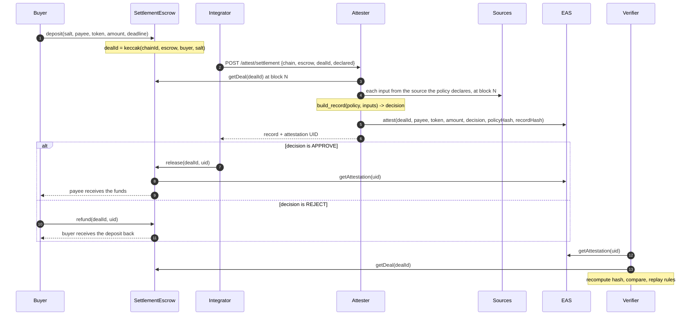

# Architecture

AttestRWA has one product and three supporting parts.

| Part | Path | Role |
|---|---|---|
| Decision Record v0.1 | [`spec/`](../spec) | The format: what a record contains, how it is hashed, how it is anchored and verified. |
| Library and verifier | [`packages/attestrwa`](../packages/attestrwa) | Reference implementation of the format: canonical JSON, policy packs and the rule language, record construction, `attestrwa verify`. |
| Escrow | [`contracts/`](../contracts) | Reference consumer: settles a deposit on a `SettlementDecision` attestation. |
| Attester | [`apps/api`](../apps/api) | Reference producer: reads a deal, gathers inputs, builds the record, anchors it. |
| Web UI | [`apps/web`](../apps/web) | A live settlement page and a browser verifier. |

The format and the verifier stand on their own. The escrow and the attester show one complete use of them.

## Flow

## Design decisions

**The decision is a pure function of the policy and the inputs.** `attestrwa.record.build_record` evaluates every rule and approves if and only if all hold. The attester contains no decision logic of its own. This is what makes replay meaningful: a verifier that re-runs the rules over the recorded inputs reaches the decision the attester reached, or the record is wrong.

**Sources are declared by the policy and recorded with each value.** A policy pack states, for every input, its type, the kind of source and the source itself: which subject field, which contract call about which party, which registry. The attester fetches exactly that; the verifier checks the record against the declaration. Two failures are closed by this: a value the policy expects from the chain arriving as a caller's claim, and the right rules being applied to the wrong facts.

**The attester reads the deal; the caller names it.** A request carries a chain id, an escrow address and a deal id. Buyer, payee, token and amount are read from the escrow at one block. The attester serves one configured escrow and refuses requests about any other, so it cannot be pointed at a contract that returns invented deals.

**One snapshot.** Every on-chain input is read at `evaluation.block_number`, and `evaluation.evaluated_at` is that block's timestamp. A record cannot combine readings from different moments.

**One live decision per deal.** A repeat request returns the stored record. A new decision is made only after the earlier attestation has been revoked on-chain; the new record names it in `supersedes` and the new attestation references it in `refUID`. Without this, an approval and a rejection could both be live and the outcome would depend on who transacts first.

**Hashes on-chain, the record off-chain.** The attestation carries the outcome, the policy hash and the record hash. The escrow needs nothing more, and the reasons need not be public.

**The escrow interprets as little as possible.** It checks that an attestation is a live decision by a trusted attester, addressed to it, made after the deposit, about exactly this deal, with the expected outcome. Policy semantics never enter the contract, so a policy change needs no contract change.

**State reads only.** The verifier uses `eth_call` and `eth_chainId` (plus one block header lookup, reported as skipped when unavailable). Public RPC endpoints prune old receipts and logs; contract state stays readable.

**Fail closed.** If a source cannot be read, the attester makes no decision and answers with an error. A failed transaction is an error, not a decision.

## Components

### Library (`packages/attestrwa`)

| Module | Contents |
|---|---|
| `canonical` | Strict RFC 8785 subset; a JSON loader that refuses duplicate keys and floats. |
| `policy` | Policy packs, the lexer and parser of the rule language, the typed interpreter. |
| `record` | Record validation, construction, hashing; checks of inputs against sources and against the policy. |
| `eas` | The `SettlementDecision` schema, its UID, encoding and decoding. |
| `rpc` | A minimal JSON-RPC client and decoders for the EAS and escrow views. |
| `registry` | Payee registry files. |
| `verify`, `cli` | The verifier and its command line. |

Runtime dependencies: PyYAML and PyCryptodome.

### Escrow (`contracts/src/SettlementEscrow.sol`)

See [ATTESTATION_SCHEMA.md](ATTESTATION_SCHEMA.md) for what the contract checks, and [THREAT_MODEL.md](THREAT_MODEL.md) for what it guarantees.

### Attester (`apps/api`)

| Module | Contents |
|---|---|
| `service` | Orchestration: idempotency, reading the deal, building and anchoring the record. |
| `providers` | One resolver per source kind, driven by the policy's declarations. |
| `chain` | The write path: `EAS.attest` with a pending nonce under a lock. |
| `store` | Immutable record files, by hash and by deal. |
| `main`, `auth`, `schemas` | HTTP surface; see [API.md](API.md). |

### Web (`apps/web`)

`/settle` drives the real flow. On the local fork it signs with the public development account, so no wallet is needed; on another network it uses the browser wallet. The attester's API key stays in a server route. `/verify` runs in the browser alone.
